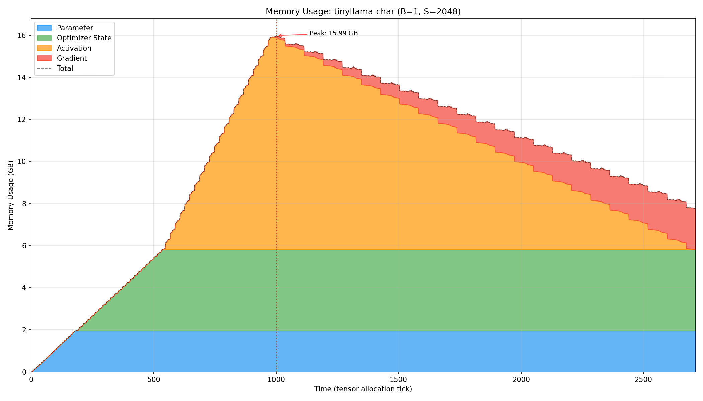

# tt-train-roofline

Roofline performance analysis tool for training transformer models on Tenstorrent hardware. It simulates a full training loop — forward pass, backward pass, optimizer step — using metadata-only mock tensors, estimating ideal execution time, memory usage, and compute/memory bottlenecks without requiring actual hardware.

The module interface mirrors [ttml](https://github.com/tenstorrent/tt-metal/tree/main/tt-train) (Tenstorrent's training framework), which itself is similar to PyTorch: models are built from composable modules, operations produce and consume tensors, and gradients flow through an autograd-style backward graph.

## How It Works

Each operation (matmul, layernorm, softmax, etc.) is implemented as a `RooflineFunction` that:

1. Computes output tensor **shapes** (no actual data).
2. Calculates the **FLOPs** and **bytes transferred** for both forward and backward passes.
3. Creates a `RooflineEstimate` and registers it with the `RooflineContext`.

The `RooflineContext` accumulates all estimates across the training iteration and classifies each operation as **compute-bound** or **DRAM-bound** based on the hardware's peak TFLOPS and memory bandwidth.

A `MemoryTracker` runs alongside, logging every allocation and deallocation by category (parameters, activations, gradients, optimizer state), enabling peak memory analysis and memory usage plots.

## Architecture

```
roofline/
├── roofline/        # Core roofline math per op (FLOPs, bytes, ideal time)
├── operations/      # RooflineFunction wrappers that build the backward graph
├── modules/         # High-level modules (Linear, Attention, GPTBlock, Llama, ...)
├── training/        # AdamW optimizer, gradient clipping
├── examples/        # Ready-to-run analysis scripts
├── hardware.py      # Hardware specs (Wormhole N150/N300, Blackhole P100/P150)
├── mock_tensor.py   # Metadata-only tensor with autograd graph
└── memory_tracker.py# Allocation tracking and plotting
```

**Supported hardware:** Wormhole N150, Wormhole N300, Blackhole P100, Blackhole P150

**Supported models:** NanoGPT (char/BPE), GPT-2 (Small/Medium/Large), NanoLlama, TinyLlama 1.1B, Llama 3.x (1B, 8B, 70B, 405B)

**Supported operations:** MatMul, Linear, Embedding, LayerNorm, RMSNorm, Softmax, Scaled Dot-Product Attention (unfused & fused), RoPE, Dropout, SiLU, GELU, SwiGLU (fused), Cross-Entropy Loss

## Examples

All examples are run from the repository root.

### Full training analysis

Analyze a complete training iteration (forward + backward + optimizer) for any supported model:

```bash
# NanoGPT on Shakespeare (default)
python3 -m roofline.examples.training

# TinyLlama 1.1B, batch=1, seq=2048
python3 -m roofline.examples.training --model tinyllama -b 1 -s 2048

# Llama 8B on Blackhole P150
python3 -m roofline.examples.training --model llama-8b -b 1 -s 8192 --hardware p150

# List all available model presets
python3 -m roofline.examples.training --list
```

Outputs timing breakdown (forward/backward/optimizer), throughput (tokens/sec), bottleneck classification per op, peak memory, and memory usage plots.

Example of output:
```
======================================================================
TRANSFORMER MODEL ROOFLINE ANALYSIS
======================================================================

Hardware: Blackhole
  Cores:      120
  Clock:      1.35 GHz
  DRAM BW:    480 GB/s
  Peak (HiFi4): 165.9 TFLOPs

Model: tinyllama-char (Llama)
Description: TinyLlama 1.1B (char tokenizer, 0.96B params)

Model Configuration:
  vocab_size:         96
  max_sequence_length: 2048
  embedding_dim:      2048
  num_blocks:         22
  num_heads:          32
  num_groups:         4
  dropout:            0.0
  theta:              10000.0

Batch Configuration:
  batch_size:  1
  seq_len:     2048

Model Statistics:
  Parameters:  969,369,600 (969.4M)
  Param Memory: 1.939 GB (BF16)

----------------------------------------------------------------------
Running Analysis: B=1, S=2048
----------------------------------------------------------------------
--- AFTER_MODEL_CREATION ---
  Current Memory: 1938.74 MB
--- AFTER_OPTIMIZER_CREATION ---
  Current Memory: 5816.22 MB
--- AFTER_FORWARD_PASS ---
  Current Memory: 15914.41 MB
--- AFTER_BACKWARD_PASS ---
  Current Memory: 7754.96 MB
--- AFTER_OPTIMIZER_STEP ---
  Current Memory: 7754.96 MB
--- ITERATION_COMPLETE ---
  Current Memory: 7754.96 MB
Peak Memory Usage: 15.990 GB (15,990,300,674 bytes)
Peak Memory Breakdown by category:
  parameter      : 1.939 GB (12.1%)
  optimizer_state: 3.877 GB (24.2%)
  activation     : 10.073 GB (63.0%)
  gradient       : 0.101 GB (0.6%)

Timing Breakdown:
  Forward:     110.3905 ms (4.7669 TFLOPs)
  Backward:    194.7631 ms (9.4815 TFLOPs)
  Optimizer:   28.2733 ms (0.0010 TFLOPs)
  Grad Clip:   20.1952 ms (0.0029 TFLOPs)
  Total:       353.6221 ms (14.2523 TFLOPs)

Throughput:
  Tokens/iter: 2,048
  Tokens/sec:  5,791
  TFLOPs:      40.30

Bottleneck Analysis:
  DRAM: 961 ops
  COMPUTE: 330 ops
  BOTH: 66 ops

----------------------------------------------------------------------
Memory Tracking Analysis
----------------------------------------------------------------------
Peak Memory Usage: 15.990 GB (15,990,300,674 bytes)
Peak Memory Breakdown by category:
  parameter      : 1.939 GB (12.1%)
  optimizer_state: 3.877 GB (24.2%)
  activation     : 10.073 GB (63.0%)
  gradient       : 0.101 GB (0.6%)
Memory usage plot saved to: memory_usage_tinyllama-char_b1_s2048.png
Memory usage plot saved to: memory_detail_tinyllama-char_b1_s2048.png

======================================================================
ANALYSIS COMPLETE
======================================================================
```

Memory plot example:


### Fused vs unfused attention

Compare standard multi-head attention against fused (Flash Attention-style) SDPA across multiple model sizes:

```bash
python3 -m roofline.examples.attention_comparison
```

### SwiGLU comparison

Compare different SwiGLU MLP implementations:

```bash
python3 -m roofline.examples.swiglu_comparison
```

### Matmul benchmarking

Roofline analysis for matrix multiplications across a range of shapes:

```bash
python3 -m roofline.examples.benchmark_matmuls
```

### Simple matmul pipeline

Minimal example — a 5-layer linear model showing per-layer roofline breakdown:

```bash
python3 -m roofline.examples.matmuls
```

### Parallel training: pipeline, tensor, sequence and context parallelism

`roofline.examples.parallel_training` models one optimizer step of a Llama on `pp * tp * cp` chips:

- **PP**: interleaved 1F1B (`--interleave v`, v = 1 is plain 1F1B), optional vocabulary parallelism (`--vocab-parallel`, LM head split across stages)
- **TP** inside a stage, optionally with Megatron sequence parallelism (`--sp`)
- **CP** inside a stage: ring attention with a load-balanced split and K/V shifts in both ring directions
- activation recompute (`--recompute`, the memory-efficient runner)

```bash
# One configuration: Llama 70B, 8K sequences, 2048 sequences per step, on a quad galaxy (128 chips)
python3 -m roofline.examples.parallel_training --model llama-70b -s 8192 -m 2048 \
    --pp 16 --tp 2 --cp 4 --recompute --vocab-parallel --attn-bwd-kv-block 512

# Every PP x TP x CP split of 128 chips, best ones that fit in memory
python3 -m roofline.examples.parallel_training --model llama-70b -s 8192 -m 2048 \
    --sweep 128 --sp --vocab-parallel --attn-bwd-kv-block 512
```

The first and the last pipeline stage are each run for one micro-batch in their own `RooflineContext`. Step time is a resource-level roofline: compute, DRAM and fabric (Ethernet) time are summed separately and the largest one sets the time, so the three overlap:

```
D       = max(FLOP, DRAM, fabric) for one micro-batch on the slowest stage
          (fabric includes 2v stage hand-offs per micro-batch)
T_step  = max( (m + (P - 1)/v) * D + max(optimizer FLOP, optimizer DRAM),  m * fabric + CP gradient sync )
bubble  = (P - 1) / (v * m + P - 1)
MFU     = (6 N + 12 L H Q S) * tokens / T_step / (chips * peak)       (tt-train's MFU formula)
```

The per-op serial time (sum of `max(compute, DRAM, network)` over ops, as in `training.py`) is reported next to it.

Supporting changes:

| Where | What |
|---|---|
| `RooflineEstimate.ideal_network_ns` | Collectives put their time on the fabric instead of DRAM; `theoretical_time_ns = max(compute, memory, network)`, so existing totals are unchanged |
| `RooflineContext.compute_time_ns / dram_time_ns / network_time_ns / overlapped_time_ns` | Per-resource sums and their max |
| `fused_attention_roofline(..., bwd_kv_block)`, `RooflineContext.attn_bwd_kv_block` | Backward re-reads Q, O, dO and dQ once per K/V block; default one 32-token tile (current kernel). 512 makes the backward compute-bound |
| `ring_shift_roofline`, `send_recv_roofline` | CP ring shifts (both ring directions) and stage hand-offs over the links across a stage cut |
| `MockRingAttentionOp`, `cp_size` on the distributed block | Ring attention: attention of the full sequence divided by `cp`, K/V (bf16) shifts forward, K/V + dK/dV (fp32) backward, fp32 accumulator read + write per ring step |
| `sequence_parallel` on the parallel linears, attention, MLP, block | All-gather / reduce-scatter along the sequence instead of broadcast / all-reduce; norms and residual adds hold `S / tp` tokens |
| `MockLlamaPipelineStage`, `training/pipeline.py` | One pipeline stage; interleaved 1F1B order and simulator (activations held per device) |
| `BLACKHOLE_QUAD` | 4 galaxies, 128 chips, 32 x 4 torus, 2 links per neighbouring chip pair |

Limitations: TP must divide the number of KV heads (as in tt-train). With `--sp` each column-parallel linear keeps its all-gathered input for backward (Megatron keeps the shard and re-gathers), so memory is higher than Megatron's. The communication of vocabulary parallelism is not modelled. `--cut-links` (default 8) assumes stages laid along the 32-chip axis of a quad.

## Dependencies

Python 3.10+ with only standard-library dependencies. `matplotlib` is optional (used for memory usage plots).
